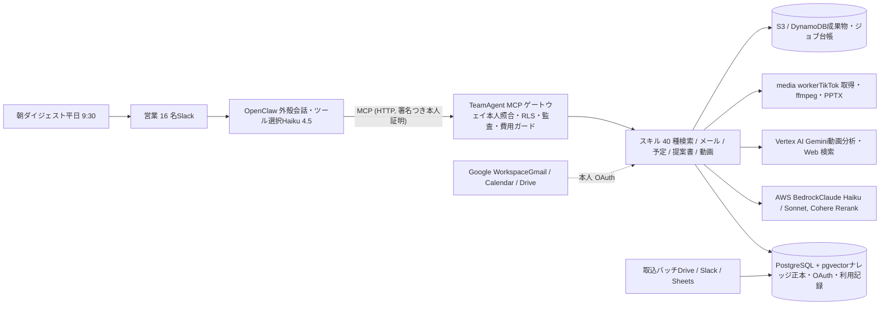
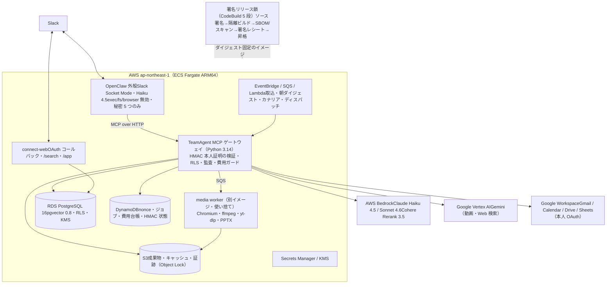
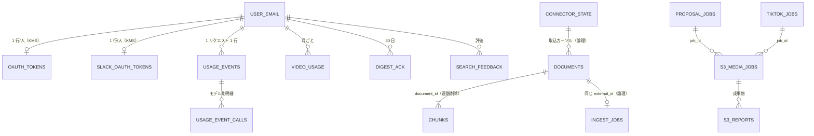

# Aico 技術資料

ご依頼の 4 点（要件定義／機能仕様書と機能ごとのユースケース／選定したアーキテクチャと主な理由／現在想定しているデータ構造とデータ量）を 1 冊にまとめた。記述はリポジトリの設計文書とコード、本番の実測（2026-09-18 取得）に基づく。第 2 版で機能の公開状態を本番の設定値で突合し、文書側のずれは修正 PR（#432）で解消。第 3 版は 9/18 のリリース r27（Gemini 3.5 系への切替・apk ロック追随）を本番に反映した後の状態で書き直した。推測は「未確認」と明記する。

## 0. 全体像（3 分で読む）

1. **何か。**Slack で「@Aico」に話しかけると、社内の提案書・議事録・メール・Slack を横断検索して引用つきで答え、朝のメール要約と予定、返信下書き、提案書や動画分析まで行う社内 AI アシスタント。営業約 16 名で稼働中（2026-06 本番開始）。
2. **どう動くか。**Slack 側の外殻（OpenClaw）はツール選択と会話だけを担い、認可・データアクセス・監査はすべて内側のゲートウェイ（TeamAgent MCP）で行う。LLM は AWS Bedrock の Claude（文章）と Google Vertex AI の Gemini 3.5 Flash-Lite（動画・Web 検索・会社プロジェクトで後払い課金）。データの正本は PostgreSQL（pgvector）1 台。
3. **データの大きさ。**ナレッジ約 2,500 文書、DB 使用 5 GiB、成果物 S3 5.5 GB、月額 AWS 約 360 ドル。小〜中規模で、設計上の重心は「本人しか見えない」を機械的に守る境界設計と、署名つきの安全なリリースにある。

_図: 実行系の要約。矢印は主な呼び出し方向。詳細は §3。_

## 1. 要件定義

_出典: README、docs/v3.2 系の仕様・決定台帳、旧要件定義 v3.0（2026-05）、コード（スキルの docstring・設定）。「文書」「コード」「運用記録」を区別して記す_

### 1.1 目的と対象

| 項目 | 内容 | 出典 |
|---|---|---|
| 一文定義 | Slack を入口に、OpenClaw＋TeamAgent MCP ゲートウェイ＋AWS Bedrock Claude で動く社内 AI エージェント基盤。営業ナレッジ検索・クライアントカルテ・提案書生成・メール要約と下書き・カレンダー・TikTok/X 分析を、本人単位の認可と行レベルセキュリティの内側で実行する | README |
| 中核体験 | 営業が Slack から過去の提案書・議事録・メールを自然文で検索し、引用つき要約を得る | 概要書 v3.2 |
| 対象ユーザー | ベクトル社（ショート動画 PR）の営業 16 名。同時利用想定 4 名。将来 100 名〜全社。実配信は朝ダイジェスト 23 名（09-17）、連携台帳 15 名（09-03） | README・SLO 文書・運用記録 |
| 方針 | 「できません」で利用者に手作業を振らず、安全装置つきで Aico 側が実行する（09-04）。デプロイは署名鎖を通し、随時・自走（09-17） | 運用記録 |
| 業務ドメイン語彙 | ビデオリリース／TTO・切り抜き／タテガタ／VSEO・検索面／お土産資料／営業 FB・カルテ／BANT | SOUL.md（振る舞い規範） |

### 1.2 解決する業務課題

- 散在資料（Slack・Drive・Sheets・メール）を「会社の脳」として横断検索したい。営業 FB（商談フィードバック）を DB にしたい
- 「あの会社、今どうなってる？」に即答したい（クライアントカルテ）
- メールの要約・要返信の見落とし防止・返信下書き（送信は人が行う）
- 検索キーワードで上位に出る TikTok 動画が「なぜ上位か」を読み解く（VSEO）。初訪向け「お土産資料」と提案書（83 枚）の生成工数を下げる
- 旧要件の狙い（歴史）: 提案書作成 20 時間→8〜12 時間、引用率 90%・捏造率 0%

### 1.3 機能要件（系統別）

スキルは 40 ディレクトリ、Slack に公開しているツールは 38 本（設定ファイル 2 つの照合結果）。詳細は §2。

| 系統 | 機能 | 要点 |
|---|---|---|
| 検索・ナレッジ | search／clientkarte／knowledge_deliver／recommend／pre_meeting_brief | pgvector＋再順位付けの社内 RAG、カルテ合成、実ファイル配信、当日商談相手向け事例 |
| メール・予定・朝ダイジェスト | mail_summary／mail_followup／mail_reply／mail_draft／morning_digest／calendar_*／schedule_propose／oauth_connect | 本人 OAuth、送信・削除は物理封鎖、朝 9:30 の DM |
| Slack 要約・添付 | slack_summary／attachment_assist／operation_log | 本人トークンのみで読み、添付は要約・修正案・議事録・集計・英訳 |
| 提案書・資料生成 | proposal_draft／proposal_review／proposal_builder／omiyage_report／clip_proposal | 骨子・講評・83 枚 PPTX・お土産資料・切り抜き提案 |
| 動画・TikTok・X | tiktok_search／tiktok_acquire／video_analysis／video_algorithm／video_approval／video_capture／search_surface_check／tiktok_comment_mining／x_*／web_research | Gemini 動画分析、実ブラウザ取得、Apify 縮退、Web 検索グラウンディング |

### 1.4 非機能要件

| 観点 | 要件と実装 | 状態 |
|---|---|---|
| **セキュリティ** |
| 本人照合 | Slack イベント由来の利用者・チーム・チャンネルとツール引数を一回限りの署名（HMAC・60 秒・DynamoDB で再利用不可）に束ね、ゲートウェイが検証してから Slack API で email を解決。LLM が申告した身元は全破棄。ゲスト・外部ワークスペース・bot は拒否 | 【稼働】 |
| 権限 | 役割はサーバ側で常に一般利用者に固定（LLM 経由の昇格は構造的に不可）。PostgreSQL の行レベルセキュリティ（強制・迂回不可）で所有者／許可メール／許可グループの行だけ見える。設定が無ければ何も見えない（fail-safe） | 【稼働（DB 実機テスト 28 件）】 |
| 本人 OAuth | Google の更新トークンは KMS で本人 email に束ねて暗号化。読み取り中心のスコープ。連携リンクは本人専用・使い捨て | 【稼働】 |
| 外部送信の封鎖 | Gmail は下書き作成のみ（送信・削除はアダプタで物理封鎖）、Calendar は本人予定の登録のみ（招待なし）、Drive 書込なし、外殻からのシェル・ファイル・ブラウザ操作は設定で無効 | 【稼働】 |
| DLP | メール系は本人受信箱限定・生本文をログや返答に出さない・相手先はマスク。Sentry は PII を伏せる。LLM 送信前の一般 PII マスクは無い（既知の弱点） | 【一部】 |
| 監査 | 構造化ログ（request_id 貫通）、利用記録テーブル（1 リクエスト 1 行）、CloudTrail（複数リージョン・改ざん検知）、なりすまし拒否の計測 | 【稼働】 |
| 供給網 | ベースイメージと依存はダイジェスト固定、脆弱性スキャンで Critical/High ゼロが昇格条件、秘密は Secrets Manager のみ | 【稼働】 |
| **可用性・性能** |
| 応答時間の目標 | 軽量 3 秒以内／検索 15 秒以内／動画など重量 5 分以内（p95）。実測は検索 10〜20 秒帯、ツールの同期上限は 600 秒 | 【検索 p95 は未確定】 |
| 非同期処理 | TikTok 取得・X 計測は SQS→Lambda→使い捨て Fargate。提案書・お土産資料は MCP 内スレッド＋DynamoDB ジョブ台帳で「まだ？」で照会 | 【稼働】 |
| 同時実行制御 | 入場制御（同時 4・待ち 64）はコードにあるが本番経路に未配線。実効は 1 タスク・接続プール 8 | 【未配線】 |
| 可用性目標 | 月 99.0%、エラー率 1% 以内。DB はシングル AZ・7 日バックアップ。DR 訓練は未実施 | 【目標のみ】 |
| **コスト** |
| 4 層ガード | AWS Budgets／1 実行の上限（0.5 ドル）／外部 SaaS 台帳（DynamoDB・fail-close）／動画本数クォータ（月 20 本/人） | 【稼働】 |
| 単価の実測 | 検索 1 回 0.01〜0.02 ドル、動画分析 1 本 0.004 ドル前後、提案書 1 本 0.7〜0.8 ドル、AWS 月額約 360 ドル（08-14） | — |
| **運用** |
| リリース | ソース署名→隔離レジストリでビルド→SBOM とスキャン→署名レシート→昇格→terraform の計画時ゲート。イメージ参照は必ずダイジェスト。直接 push や素の apply は禁止経路 | 【稼働】 |
| 変更凍結 | 世代入力 18 件を凍結面として CI が機械強制。解除は PR 内で宣言（人の関門つき） | 【稼働】 |
| 監視 | 費用・エラー・なりすましのメトリクス、p95 と 5 分 3 エラーのアラーム、1 時間ごとの合成カナリア、Sentry | 【稼働】 |
| 完了定義 | デプロイ後は run-task 検証と Slack 実機 1 往復まで「完了」としない | 規約 |

> 旧要件（2026-05 の v3.0・317 項目）との突合: 一致 53／前倒し 17／強化 17／方式変更 48／部分 103／未実装 76／不要化 3。未実装の主なもの: 引用の信頼度ラベル、薬機法・景表法・ステマ規制チェック、生成文の出口での PII マスク、週次サマリー、Slash コマンド UI、削除伝播・保持期間ポリシー。

## 2. 機能仕様書とユースケース

_露出（2026-09-18 に本番 mcp タスク定義 112 の設定値で確認）: 【本番 ON】 全員に公開 ・ 【本番 ON・許可制】 ・ 【未点灯】 実装済みで未公開（設定 OFF か配線待ち）・ 【実装中】_

### 2.1 検索・ナレッジ

| 機能 | 頼み方 | 入力 | 処理 | 返し方・上限 | 露出 | ユースケース |
|---|---|---|---|---|---|---|
| search | 「◯◯社の提案で響いた訴求は？」「議事録ある？」 | 自然文、任意で業種・クライアント・資料種別・予算の絞り込み | e5 埋め込み（1024 次元）→ pgvector 近傍 30 件＋クライアント名ブースト→ Cohere で上位 5 件→ 弱い根拠は「記載なし」→ RLS → Claude Sonnet が引用つきで回答。集約モード（「失注案件の一覧」）あり | 回答＋ヒット（ファイル名・ページ・URL・案件フェーズ）。Web UI へのリンク付与。上位 50 件まで | 【本番 ON】 | 商談前に過去提案の URL を得る／「VVS と TTO の違い」を社内用語辞書から |
| clientkarte | 「◯◯社どうなってる？」「いまから◯◯社」 | クライアント名、件数 | 営業 FB を時系列に束ね、提案履歴・温度感・次の一手を合成。関連資料は本人 DM に実ファイル添付（最大 5 件・50MiB） | カルテ本文＋イベント一覧。チャンネルでは件数 1 行のみ | 【本番 ON】 | 訪問前にカルテ＋メール要約＋過去資料を 1 通で受け取る |
| knowledge_deliver | 「資料そのものを出して」 | 検索語 | 検索＋要約に加え Drive から実体を取得し、依頼スレッドか本人 DM に添付 | 失敗しても要約は返す | 【本番 ON】 | 会議中に「あの資料ちょうだい」 |
| recommend | 新規案件の概要を貼る | 案件概要 | 類似の提案書・議事録・営業 FB を 3 系統×3 件提示（LLM 要約なし） | 一覧 | 【未点灯（設定 OFF）】 | 新規案件で参考事例を集める |
| pre_meeting_brief | 朝ダイジェスト内に自動で出る | 当日の社外予定 | 予定の相手先に効く自社事例を事例集から並べる（LLM 非経由） | ダイジェストの一節 | 【未点灯（設定 OFF）】 | 朝の時点で商談相手向けの事例が手元にある |

### 2.2 メール・カレンダー・朝ダイジェスト

共通前提: すべて本人の OAuth（Gmail は modify スコープ 1 本・社内向け同意画面）。本人の受信箱のみ。送信・削除はアダプタで封鎖。結果は本人にだけ返す。連携は「@Aico 連携」で本人専用 URL を返す。

| 機能 | 頼み方 | 処理・LLM | 返し方・制約 | 露出 | ユースケース |
|---|---|---|---|---|---|
| mail_summary | 「◯◯社のメール要約して」 | 本人 Gmail（読取）→ マスク → Claude 要約 | 要点と件数。クライアント＋期間で必ず絞る | 【本番 ON】 | 訪問前に直近のやり取りを把握 |
| mail_followup | 「返信漏れある？」 | メタデータのみ・LLM 不使用 | 止まっているスレッド一覧 | 【本番 ON】 | 週次の返信漏れ点検 |
| mail_to_internal_context | 「このメール、社内で誰か触れてた？」 | 受信箱メタ走査＋社内 RAG 突合 | 社内参照リンクつき | 【本番 ON】 | 引き継ぎ時の背景把握 |
| mail_reply | 「◯◯社に返信の下書きを」 | Claude 起草→ Gmail 下書き保存。曖昧なら候補提示 | 下書き URL。送信は人 | 【本番 ON】 | 下書きを開いて手直しして送る |
| mail_draft | 朝ダイジェストの「下書きを作成」ボタン | 署名トークン検証→ mail_reply を起草エンジンとして呼ぶ | 本人が選んだ件のみ | 【本番 ON】 | 朝 9:32 にボタン 1 つで下書き |
| morning_digest | 平日 9:30 に自動 DM | メール要約＋当日予定＋Slack 未返信＋返信下書き（最大 5 件）＋事例ブリーフを Block Kit で | ボタン: 下書き作成／確認済み／予定登録／日程候補 | 【本番 ON（23 名配信）】 | 朝の最初の 5 分で「要返信 X・確認 Y・下書き Z」 |
| calendar_event／calendar_freebusy／schedule_propose | 「明日空いてる？」「◯分どこに入る？」「予定入れて」 | freebusy と予定一覧の読取、本人予定の登録のみ | 招待は送らない | 【本番 ON】 | 日程候補入りの返信下書きを作る |
| oauth_connect | 「連携」 | 未連携分の本人専用 URL を発行（URL 自作禁止・聞き返し禁止） | 連携済みなら「追加操作不要」 | 【本番 ON】 | 初回利用時の Google・Slack 連携 |

### 2.3 Slack 要約・添付

| 機能 | 頼み方 | 処理 | 制約 | 露出 | ユースケース |
|---|---|---|---|---|---|
| slack_summary | 「このスレッド要約して」 | 本人トークンだけで読み、Claude 要約 | 発信元チャンネル以外は要約しない（持ち出し防止）、非公開の存在を明かさない | 【本番 ON】 | 長いスレッドの追いつき |
| attachment_assist | 添付して「要約して／議事録にして／集計して／英訳して」 | 読み取り専用・テキスト返答。集計はサーバがセルから計算 | 30MB 超・画像・動画・zip は非対応 | 【本番 ON】 | 会議メモを議事録フォーマットへ |
| operation_log | スレッドから CRM 転記用に抽出 | 案件フェーズ・BANT を Haiku で抽出 | 成功率 80% 以上が目標 | 【未点灯】 | 商談スレッドを CRM 項目へ |

### 2.4 提案書・資料生成

振り分け: 初訪＝お土産資料、既存案件＝骨子（proposal_draft）、講評＝proposal_review、83 枚 PPTX＝proposal_builder（内部テスト段階）。

| 機能 | 入力 | 処理 | 出力・上限 | 露出 | ユースケース |
|---|---|---|---|---|---|
| proposal_draft／proposal_review | 案件ブリーフ／提案テキスト | 類似過去提案を検索し、Sonnet で骨子・講評 | 骨子と出典／診断と出典 | 【本番 ON】 | 既存案件の「たたき台」と「レビュー」 |
| proposal_builder（submit／status） | 市場調査 JSON（現在は人が Gemini アプリで作成）＋投稿開始日＋商材情報 | 事例 RAG・保護アカウント選定・TikTok 実測 → 95 枠を Sonnet が埋める（自己修復 4 回）→ 出典検査 → 統合フォーマット 83 枚へ流し込み（media worker）→ Slack 添付 | ready／draft、カバー率。1 本 0.7〜0.8 ドル・数分 | 【本番 ON（09-16 点灯・ドラフト添付は内部向け）】 | 営業が JSON と日付を渡し、数分後に PPTX を受け取る |
| omiyage_report（submit／status） | ブランド・競合・キーワード | 検索軸ごとに TikTok 実測→動画解析→決定論集計→PPTX 2 通 | 16〜41 分・同時ジョブ上限 | 【本番 ON】 | 初訪前の「お土産資料」 |
| clip_proposal | ビデオリリース MP4 | 文字起こし→訴求軸→切り抜き 10 本→PPTX（Gemini 3 コール） | 1 人 2 本/日・1 依頼 1 ドル | 【実装中】 | 納品動画から切り抜き案 |

### 2.5 動画・TikTok・X 分析

| 機能 | 入力 | 処理・外部 | 出力・上限 | 露出 | ユースケース |
|---|---|---|---|---|---|
| tiktok_search | キーワード／ハッシュタグ | 実ブラウザで上位動画のメタを取得→ Gemini 横断分析。Apify 縮退 | 一覧＋分析＋レポート | 【本番 ON】 | 検索面の顔ぶれを即時把握 |
| tiktok_acquire | キーワード群 | SQS→Lambda→使い捨て Fargate で動画本体を S3 へ | 非同期・ジョブ ID | 【本番 ON】 | 3 キーワード以上の検索面チェックの前段 |
| video_analysis | 動画 URL | YouTube は Gemini 直接、TikTok・IG は一時取得→分析→破棄 | 月 20 本/人、結果キャッシュ | 【本番 ON（月 20 本/人）】 | 競合 PR 動画の構成・フック・テロップ・CTA |
| video_algorithm（VSEO） | 検索キーワード | 上位 5〜10 本を時刻つき構造分析→横断で勝ち筋→HTML レポート（署名 URL 7 日） | 600 秒以内 | 【本番 ON（深掘り 5 本・盤 30 本）】 | 「新宿ランチで勝ってる動画はなぜ勝つか」 |
| video_approval | 納品動画 URL＋オリエン | 必須要素・NG・テロップ誤植・尺を Gemini が照合し一次フィードバック | タイムコードつき指摘 | 【未点灯】 | 編集者の納品を自動で一次チェック |
| search_surface_check／tiktok_comment_mining | キーワード×媒体／動画 URL | TikTok と Instagram の勢力図分類（Claude）、コメント欄の反応分類 | レポート | 【本番 ON】 | クライアントが検索面に居るか、生活者の語彙 |
| x_voice_search／x_needs_mining／x_buzz_measure | 商材・キーワード・キャンペーン日 | Apify で X の実在投稿を取得、Sonnet で分析。費用ガード | 投稿本文は改変禁止 | 【本番 ON（許可リスト空＝全員）】 | 提案書に貼る生活者の声、発話量の前後比較 |
| web_research | 質問文（200 字以内） | Gemini の Google 検索グラウンディング 1 回。出典はメタデータから機械生成 | 出典つき要約 | 【本番 ON（全員）】 | 市場動向を出典つきで 3 点 |

> 共通の UX: 依頼メッセージにリアクションで進捗（👀→🧠→🛠️→✅・本番 ON）。ツールは末尾に「次の一手」を 1 行だけ添え、利用者が応じたときだけ実行する。会話履歴は DM・チャンネル単位で 20 件。動画の指定時刻の静止画切り出し（video_capture）も本番 ON。本番で OFF のもの: 確認済みボタン（digest_ack）、推薦（recommend）、事例ブリーフ（pre_meeting_brief）、切り抜き提案（実装中）、完了通知（async_notify）、L2 オーケストレータ（run_agent）。

## 3. アーキテクチャと選定理由

_構成図と、構成要素ごとの「担当・理由・不採用の代替案」。経緯は決定台帳と ADR から_

### 3.1 意思決定の経緯

| 時期 | 決定 | 理由 |
|---|---|---|
| 2026-05 | v3.0: Agent SDK 単独・Lambda×4＋Fargate のサーバーレス構成、OpenClaw は不採用 | 初期設計 |
| 2026-05 下旬 | 訂正: OpenClaw は Agent SDK 非互換・TypeScript 製・供給網事故（悪性スキル多数）でリスク評価不足。4 案比較 | 資産流用と安全性 |
| 2026-06-09 | OpenClaw を「外殻（L0）」としてだけ採用。ドメインは飲ませず、MCP 境界・Docker 隔離・最小 IAM・営業データ非接触・なりすまし対策で封じ込め | 多チャネル接続と Bedrock 公式対応を活かしつつ信頼境界を内側に置く |
| 2026-06-12 | 本番開始（実返信 3.3 秒） | — |
| 2026-07-17 | Agent SDK を撤去し、Anthropic Python クライアントの自前ループへ。core イメージから Bun/JS を排除 | ランタイムの単純化と供給網の縮小 |
| 2026-08-18 | 次世代（Hermes）は「dark なツールとして段階導入」。一括置換はしない | 16 名の生命線を止めない |
| 2026-09-17〜18 | Gemini を個人課金の GCP（ntv-ai）から会社プロジェクト（newstv-508906）へ移行。2.5 Flash 廃止（10/16）に備え 3.5 Flash-Lite（location global）へ切替、9/18 の r27 で本番反映 | 請求先と継続性。API キー方式は前払い必須のため不採用 |

### 3.2 構成要素ごとの担当と理由

| 構成要素 | 担うこと | 選んだ理由 | 代替案と不採用理由 |
|---|---|---|---|
| OpenClaw 外殻 | Slack 接続、スレッド返信、セッション分離、軽量なツール選択（Haiku）。信頼境界の外 | Slack と多チャネルが設定で済み、Bedrock に公式対応。用途を「殻」に限定し、シェル・ファイル・ブラウザは構造で塞ぐ | 自前 Bolt ボット（多チャネル自前実装が必要）、TypeScript 全面移行（資産流用ゼロ）、サブプロセス連携（起動が毎回数秒） |
| TeamAgent MCP ゲートウェイ | 本人照合、RLS、失敗時閉鎖、監査、長文退避、検索リンク付与。唯一の認可境界 | 外殻は単一信頼オペレータ設計で認可境界にならないため、認可は内側で死守。HTTP の MCP で資格情報とネットワークを分離 | FastAPI 直呼び（MCP 境界で同等を実現）、mTLS（VPC 閉域＋SG＋bearer で代替） |
| スキルレジストリ | 業務ロジック 40 種。宣言的登録と Pydantic 入出力、3 層分離を CI で強制 | 「抽象はあるが本番で使われない」負債を排し、登録が唯一の真実源 | ケイパビリティ体系の再編は未着手（外殻移行を優先） |
| ECS Fargate（ARM64） | 常駐 3 サービス＋定期タスク＋使い捨てワーカー | タスク単位の IAM で権限分離、水平拡張可。Lambda は 15 分制限と起動遅延で重バッチに不向き | 単一 EC2（バースト隔離とスケールが弱い・08-03 に停止）、Lambda×4＋RDS Proxy（全面不採用） |
| RDS PostgreSQL＋pgvector | ナレッジ正本、OAuth トークン、利用記録。RLS で行権限 | pgvector 0.8 以上（古い版はフィルタで結果ゼロの不具合）。暗号化・SSL 強制・IAM 認証 | Redis 3 層メモリ（未導入・外殻セッションで部分代替）、Multi-AZ（想定のみ） |
| 埋め込み e5（ローカル同梱） | クエリと本文の埋め込み | 要件を満たし API 課金ゼロ。差し替え口を確保 | Bedrock Titan・Voyage・Cohere 埋め込み（PoC 未実施） |
| Cohere Rerank（Bedrock） | 近傍 30 件→上位 5 件 | 評価セットの正解率 20%→64% を実証 | BM25 とのハイブリッド（設計のみ） |
| Bedrock Claude | 文章系 LLM。外側は Haiku、重い合成は Sonnet | Anthropic 直接契約の政策変動を遮断、IAM 認証で API キー不要、2 段で費用最適化 | Anthropic 直 API（副経路の手順書は未整備） |
| Vertex AI Gemini（3.5 Flash-Lite・location global・会社プロジェクト newstv-508906） | 動画のマルチモーダル分析、Web 検索グラウンディング | A/B 実測でテロップ読み取りが Gemini 24 枚に対し Nova 0〜5 枚。テロップは VSEO と納品チェックの核心。API キー方式は前払い課金が必須で会社の後払いと合わないため Vertex（標準 Cloud 課金）を使う | Amazon Nova（AWS 一本化・安価だが品質不足）、フレーム抽出＋Claude（音声を失う・将来）、Gemini API キー（前払い・請求先単位で全断・不可逆） |
| media worker | TikTok 取得、yt-dlp、ffmpeg、PPTX 変換 | core と分離し、ワーカーに AWS 資格情報を渡さない（署名 URL 受け渡し）。SSRF 防御 | 外部 VSEO SaaS の統合（自前で代替）。Apify は縮退経路のみ |
| S3／DynamoDB | 成果物（署名 URL 7 日）、統合フォーマット（版固定・KMS）、証跡（Object Lock）／nonce・ジョブ・費用台帳・HMAC 状態 | ログイン不要の配布、使い捨てワーカーが IAM だけで記帳、認可の線形化点（条件付き書込） | — |
| 署名リリース鎖＋terraform ゲート | ソース署名→隔離ビルド→スキャン C0/H0→署名レシート→昇格→計画時ゲート | 「ローカル合格・マージ・CI 緑のどれも単独では GO ではない」。凍結面は機械強制 | 素の terraform apply（過去に本番全断） |
| Secrets Manager／KMS | トークン・鍵・DB URL・Vertex SA。OAuth トークンは本人 email に束ねて暗号化 | 平文禁止・IAM ロールで受け渡し | — |
| connect-web | OAuth コールバック、検索 Web UI、Aico Vault（ナレッジ閲覧）、短縮リンク | 外殻に連携経路が無い。EC2 から Fargate へ移し EC2 を廃止 | — |

## 4. データ構造とデータ量

_2026-09-18 11:21〜11:32 JST に AWS の読み取り API で実測。行数など DB 直接の値は文書値（日付つき）。共通部分は共通としてまとめ、機能別に関連づける_

1. **正本は RDS 1 台。**検索用のナレッジ（documents／chunks）と、利用者ごとの OAuth トークン・利用記録など約 20 表。
2. **周辺は 4 系統。**ジョブ台帳＝DynamoDB、成果物・動画・キャッシュ＝S3、会話状態＝OpenClaw の EFS、監査＝CloudWatch Logs／CloudTrail／証跡バケット。
3. **メール・予定・Slack の本文は保存しない。**都度 API で読み、保存するのは検索用ナレッジと運用メタだけ。

### 4.1 共通データ

| 区分 | 実体 | キー・主要列 | 索引・保護 | 保持 | 使う機能 |
|---|---|---|---|---|---|
| ナレッジ正本 | RDS documents | id（UUID）、(source_type, external_id) 一意、種別（pdf/gdrive/gmail/slack/gsheets）、owner_email、acl_emails[]、acl_groups[]、client_code、metadata（JSONB）、modified_at | GIN（ACL・metadata）、trgm（title）。RLS: 所有者／許可メール／許可グループ | 削除ポリシー無し（再取込で上書き） | 検索・カルテ・推薦・事例ブリーフ・提案骨子・Web 検索・取込 |
| 検索本文 | RDS chunks | document_id（外部キー・連鎖削除）、chunk_idx、content、contextualized、embedding vector(1024)、embedding_cohere vector(1024)、page_num | HNSW cosine ×2、GIN。RLS は documents 経由 | 親に従う | 同上 |
| 利用者の身元 | テーブル無し | Slack user_id→email を都度解決し DB セッション変数に注入 | 4 段防御（Slack 境界→ゲートウェイ→RLS→KMS） | — | 全機能 |
| Google 連携 | RDS oauth_tokens | user_email、refresh_token（KMS 暗号文のみ）、scopes[] | RLS 本人行のみ。閲覧ロールは暗号列を除外 | 失効経路なし（退職時手順は未整備） | 朝ダイジェスト・メール・予定・連携 |
| Slack 連携 | RDS slack_oauth_tokens | user_email、xoxp（KMS）、slack_user_id、team_id | (team_id, slack_user_id) 一意、RLS 本人行 | 同上 | 連携・Slack 要約 |
| 利用計測 | RDS usage_events／usage_event_calls | request_id 一意、user_email、skill、cost_usd、latency_ms、tokens、status、query_text（裁定により保存）／モデル別明細 | 時刻・利用者・スキル別索引。閲覧は管理者のみ | 無期限 | 全ツール・管理ダッシュボード |
| 外部 SaaS 費用台帳 | DynamoDB cost-usage | provider#YYYY-MM[#email] → マイクロ USD 加算 | TTL 90 日 | 90 日 | X 分析・コメント分析・提案書 |
| HMAC 状態 | DynamoDB hmac-state | scope／record（鍵材料なし。OAuth state 消費、ボタンとリンクのトークン） | SSE・PITR・TTL | 30 分〜7 日 | 連携・メールボタン・レポート短縮リンク |
| 再送防止 | DynamoDB caller-claim-nonces | nonce | TTL | 60 秒 | 全ツール |
| 長文退避 | S3 payload-offload/ | 返却 JSON 全文（署名 URL 7 日） | AES256 | 14 日 | 検索など会社共有系のみ |
| 会話状態 | EFS（OpenClaw） | DM・チャンネル単位の会話とツール呼び出し記録（JSONL） | 暗号化・外殻タスクのみ | 削除ルール未確認 | 外殻 |

### 4.2 機能別データ

| 機能 | 使うテーブル・バケット・キュー | データの形 | 量（実測 or 文書値） |
|---|---|---|---|
| 資料検索・事例参照 | documents／chunks（RLS）、search_feedback（Web UI の評価）、payload-offload、Bedrock Rerank | クエリ→ e5 1024 次元→ HNSW（ef_search 100）上位 30→ Rerank 上位 5→ 関連度しきい値 0.4（本番設定値で確認） | documents 794（06-16）→ 2,231（08-17・ノイズ 2,521 文書／82,945 chunk を削除後）→ ＋228（09-16 ショート動画 DB）。chunks は文書あたり約 33 の比のみ |
| 取込 | ingest_jobs（状態機械）、connector_state（カーソル）、ingest_connector_runs、ingest_source_health、ingest_source_retries、ingest_reconciliation_gaps、S3 config/ingest_sources.yaml、EventBridge 平日 18:00 | Drive 1 ファイル＝1 文書（500 字チャンク・100 字重なり・上限 2,000）、Slack 1 スレッド＝1 文書、Sheets 1 行＝1 文書または案件集計 | 1 回約 72 分・Bedrock 呼び出し 949 回（08-14）。ショート動画 DB: 3,436 行→228 文書 |
| 朝ダイジェスト | oauth_tokens（配信対象）、digest_ack（30 日）、digest_delivery（14 日）、digest_notice（14 日）、EventBridge 9:30／計画 4:00、SQS reminders.fifo→Lambda | Gmail・Calendar は都度 API。リマインドは一回限りのスケジュール | 配信 23/23（09-17）。SQS 滞留 0 |
| メール・予定・連携 | oauth_tokens／slack_oauth_tokens、hmac-state、KMS、Gmail／Calendar API | 本文・下書きは Google 側に置く | 連携台帳 15 名（09-03） |
| 提案書・お土産・切り抜き | DynamoDB proposal-builder-jobs（TTL 7 日・結果 300KB 以内）、S3 proposal-builder/（統合 FMT 48MB・アカウント DB・KMS・版固定）、media-jobs/（30 日）、vseo-proposals/ | 95 枠の JSON→ FMT 流し込み | ジョブ 5 件／6KB、FMT 48.3MB、1 本 0.7〜0.8 ドル |
| 動画・TikTok・X | video_usage（月 20 本/人）、S3 analysis-cache/（出力のみ・60 日）、media-jobs/（30 日・5 分ごと掃除）、DynamoDB tiktok-acquire-jobs／x-buzz-jobs、S3 vseo-reports/（署名 URL 7 日・90 日で低頻度層）、SQS＋DLQ | 動画バイトは分析後に破棄 | media-jobs 1,469 件／2.17GB、vseo-reports 72 件／301MB、acquire ジョブ 213 件、費用台帳 15 件 |
| Aico Vault（Web） | S3 codebuild/connect-web-app.html（版固定）、短縮リンク→レポート | 金庫内は全員閲覧（08-03 裁定） | Vault 2,036 件（07-14） |
| 監査・証跡 | CloudWatch Logs（30 日中心）、CloudTrail S3（無期限）、image-release-evidence（Object Lock 10 年）、image-deployment-intents | JSON Lines | 下表 |

### 4.3 データ量サマリ

| 対象 | 値 | 取得 |
|---|---|---|
| RDS | db.t4g.micro、PostgreSQL 16.14、gp3 20 GiB、使用 約 5.0 GiB（空き 16.08 GB）、接続 平均 26、CPU 平均 5%、Multi-AZ なし、バックアップ 7 日 | 09-18 11:21・describe と CloudWatch |
| DynamoDB（7 表） | tiktok-acquire-jobs 213 件／662KB、proposal-builder-jobs 5 件、cost-usage 15 件、他 0。合計約 0.7MB。すべて従量課金 | 09-18 11:24・describe-table（最大 6 時間遅れ） |
| S3 主バケット（raw-files） | 5.48GB／8,275 件（版込み）。現行版のみ約 2.62GB／1,595 件。内訳: media-jobs 2.17GB、vseo-reports 301MB、codebuild 66.6MB、proposal-builder 48.3MB | 09-16 の日次値と 09-18 の一覧 |
| S3 証跡ほか | image-release-evidence 4.02GB／831 件、cloudtrail 446MB／74,551 件、tfstate 513MB、bedrock-logs はほぼ空（未着地） | 09-16 の日次値 |
| EFS（会話状態） | 178MB | 09-18 11:31 |
| CloudWatch Logs | 26 グループ 合計約 87MB（connect-web 29MB、mcp 11.6MB）。保持は 30 日が中心 | 09-18 11:22 |
| LLM 費用（MCP 経路） | 平日 0.1〜0.3 ドル/日。提案書テスト日は 2〜4 ドル/日 | 09-04〜09-17 の日次合計 |
| 利用規模 | 営業 16 名が対象、連携台帳 15 名、朝ダイジェスト 23 名配信 | 文書値・運用記録 |
| AWS 月額 | 約 363 ドル（Fargate 103・VPC 80・Bedrock 65・RDS 44・ECR 22・ALB 18・KMS 14・Secrets 11） | 08-14 の集計 |

### 4.4 エンティティ関係

_実体としての外部キーは chunks→documents のみ。他は (source_type, external_id) や user_email による論理結合。_

## 5. 既知の課題・未確認事項

- **設計と実装の差** 同時実行制御が本番経路に未配線（実効は 1 タスク・接続プール 8）。mail 系が本人照合フラグを見ていない（会社共有モードでの HIGH リスクとして把握済み・次の設計論点）。利用記録（usage_events）は本番ゲートウェイ内の記録器で配線済みをコードで確認。
- **文書の鮮度 【解消】** 公開ツール数（35→38）、Python 版（3.14）、Gemini モデル、OpenClaw 版、EC2 前提の記述、未実装のハイブリッド検索の表記を修正 PR で現況に合わせた（2026-09-18・挙動変更なし）。
- **データガバナンス** 削除ポリシー・退職時のトークン失効・保持期間が未整備。audit_log 表は書き手が無い。Bedrock の入出力ログは S3 に未着地。
- **未取得の数値** DB のテーブル別行数（直接接続を避けたため）。1 日あたりの Slack リクエスト数。検索の統計的 p95。実効の予算額（設定ファイルが正）。
- **人数の表記** 設計上の対象は「営業 16 名」。実運用では Google 連携済みの全員に朝ダイジェストを配信しており、直近は 23 名。台帳の正は oauth_tokens（連携者）で、営業以外を含む。
- **期限つきの作業 【完了】** Vertex の Gemini 2.5 Flash が 2026-10-16 に廃止。後継 3.5 Flash-Lite（location global）へ 9/18 の r27 で本番切替済み（mcp・取込の設定値も global に統一）。残るのは請求レポートで会社プロジェクトへの計上を翌日確認すること。

---
2026-09-18 作成・15:00 第 3 版。リポジトリ dev @ 8598ce9（r27）、本番設定（mcp 113・取込 69・media 35・OpenClaw 48）と AWS の読み取り API、設計文書に基づく。秘密値・設定ファイルの実値は参照していない。
関連: Gemini 置き換え判定（https://claude.ai/artifact/74AGXGQqbiswQ1MHp7Mjbx）／Aico タスクボード（https://claude.ai/artifact/MsCf1y99WJzwyGHpennrPv）
