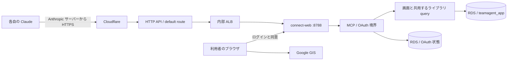

# 動画ライブラリの Claude カスタムコネクタ向け MCP 設計

作成日: 2026-11-04。対象: `feat/library-mcp`、調査時 HEAD `2329f40b`。
状態: 設計のみ。コード変更、migration 実行、インフラ変更、コミット、push は行わない。

## 0. 目的と判断の前提

社員が各自のサブスク版 Claude に登録し、「〇〇化粧品の TTO 事例で伸びた動画を出して」と依頼すると、Connect の動画ライブラリを本人の権限で検索できるようにする。検索で拾ったショート動画を Claude 上で組み合わせ、提案の材料にする。情シス承認は取得済み。Aico／Slack の機能追加ではない。

**推奨は connect-web 同居の `/mcp`、ステートレスな Streamable HTTP、Connect が発行する個人別 OAuth トークン、Google による本人確認、読み取りツール 4 本。** OAuth 状態は RDS に永続化する。公開 DCR を許すが、リダイレクト先と登録量を限定する。別 ECS サービス、独自検索エンジン、動画ファイル配信、提案生成は初版の対象にしない。

### 調査で確認した現状

| 根拠 | 確認事項と設計への影響 |
|---|---|
| [`library.py`](../../src/teamagent/connect_web/library.py): `parse_search`・`_where`・`search_videos` | NFKC 正規化、500 文字／10 語、AND 部分一致、PR 判定、属性絞り込み、並び順の許可リストがある。SQL の値はパラメータ化。動画一覧は現在 50 件固定。再利用する。 |
| 同: `search_campaigns`・`campaign_detail` | 事例のキーは `(advertiser, campaign)`。集計は最新スナップショットを使い、欠損があれば合計も不明。現在の事例検索は全件取得後に画面側でページングし、検索条件に一致した動画だけを集計する。MCP 用には DB 側の上限が必要。 |
| 同: `register_library_routes` 内部 | `is_admin(email)`、RLS 接続、動画取得 `video(...)` がローカル関数。共用のため最小限切り出す。動画詳細にも `(%s OR NOT v.is_private)` がある。 |
| [`0035`](../../infra/migrations/0035_video_library.sql)・[`0036`](../../infra/migrations/0036_video_library_settings.sql) | `vl_videos_effective` は `security_invoker=true`。非公開は案件設定の `is_private` から決まる。関連テーブルの SELECT RLS は `USING (true)` であり、**RLS だけでは非公開を隠せない**。SQL の公開条件を必ず残す。 |
| [`app.py`](../../src/teamagent/connect_web/app.py)・[`auth.py`](../../src/teamagent/dashboard/auth.py)・[`config.py`](../../src/teamagent/dashboard/config.py) | Google ID token の `aud/iss/exp` を google-auth で検証し、`email_verified` と許可設定を判定。Connect は許可 email **または**検証済み `hd` の一致で許可する。dashboard の既定は別の AND 条件なので、Connect の `_load_search_config` を使う。 |
| 同: `make_session`・`_search_email`・`_safe_next` | 画面 Cookie は email と有効期限を HMAC 署名し、`_search_email` は署名／期限を確認する。Cookie には Google の `hd` や nonce がない。`_safe_next` は任意の OAuth 復帰先を許さない。既存 Cookie を MCP トークンに流用しない。 |
| 同: `_SecurityHeadersMiddleware`・`create_app` | ヘッダ付与は pure ASGI。CSP は Google GIS を許可し、`form-action 'self'`、フレーム禁止、原則 no-store。既存 lifespan は URL import worker。これを維持して MCP の lifespan を合成する。 |
| [`mcp_gateway/server.py`](../../src/teamagent/mcp_gateway/server.py) | Aico 用は Slack identity と one-use HMAC claim を使う別境界。ツールや利用履歴処理を公開 MCP に転用しない。 |
| [`connect_web.tf`](../../infra/terraform/connect_web.tf)・[`api_gateway_hardening.tf`](../../infra/terraform/api_gateway_hardening.tf) | connect-web は既存 MCP image を別 command で利用し、8788 番で動く Fargate service。HTTP API のカスタムドメインと `$default` stage、内部 ALB を利用。execute-api の直接公開は禁止。経路／Bot 設定の live 値は今回未確認。 |

## 1. 置き場所と責務

connect-web の FastAPI に MCP 用 ASGI アプリを同居させ、公開 URL を **`https://connect.newstv.co.jp/mcp`（末尾 `/` なし）** に固定する。ポート、ECS service、ALB target group、ECR repository は増やさない。Google ログインと DB／ライブラリを既に持つため、新サービスより変更と運用が少なく、画面との認可のずれも抑えられる。



実装時の変更先は次に限定する。以下のファイル名は新設案であり、今回作成するのは本書だけ。

| 変更先 | 役割／影響する呼び出し元 |
|---|---|
| `connect_web/library_mcp.py`・I/O schema | FastMCP の組み立て、4 ツール、明示的な出力項目選択。Pydantic v2、strict な型と入力制約。 |
| `connect_web/library_mcp_auth.py` | SDK Provider、Google ログイン／同意、HTTP 境界の追加検証。Google 検証器は既存のものを注入可能にする。 |
| `adapters/library_mcp_store.py` | OAuth 状態とレートカウンタの DB 操作。SDK／connect_web／skills を import せず、引数と保存レコードだけ扱う。 |
| `connect_web/library.py` | 管理者判定・RLS 接続・詳細クエリを共用化。動画検索の既定 50 件と既存返却形を維持したまま、MCP の SQL 上限を指定可能にする。事例検索 SQL も共用し、MCP だけ DB ページングを使う。 |
| `connect_web/app.py`・必要時 `__main__.py` | フラグ、ルート、lifespan、MCP/OAuth 用ログ抑制。既存ログインの遷移先許可を拡張する必要はない。 |
| `infra/migrations/<次の番号>_library_mcp_oauth.sql` | 下記の追加テーブル、権限、期限／lookup 用 index。番号は実装時に採番。 |
| `infra/terraform/connect_web.tf`・activation 用 tfvars | OFF フラグと固定公開 URL 等を task definition に注入。既存の guarded release を使う。 |
| 関連テスト・運用ドキュメント | library 検索／詳細、認証、ヘッダ、lifespan、ログ、migration、env の契約。 |

`CLAUDE.md` §3・§5 に従い、SDK／HTTP 境界は connect_web、DB は adapters とする。ライブラリの SQL 検索を SearchSkill や embedding で作り直さない。Aico のツール登録、Slack claim、Google Drive OAuth、個人メモ等には接続しない。新規依存は不要（既に `mcp` extra と `python-multipart` があり、image は `--extra mcp` で構築）。

同居すると障害・CPU・DB pool を画面と共有する。MCP の同時実行数、SQL 時間、出力サイズを制限し、OFF で切り離せるようにする。負荷測定で画面の応答が継続的に悪化すると判明した場合に別サービスを検討する。

## 2. 転送方式とインストール済み SDK

Streamable HTTP を採用し、POST に JSON 応答を返す。MCP セッション、イベント再送、サーバーからの通知、長時間 SSE、旧 `/sse` は初版で提供しない。検索は各呼び出しで完結し、Bearer token を毎回検証するので、MCP transport はステートレスにできる。OAuth 状態は別途 DB に保持するため、再起動・rolling deployment・将来の複数 task でも認可コードと refresh token を引き継げる。

根拠: [Claude のサーバー構築資料](https://claude.com/docs/connectors/building)は Streamable HTTP を案内している。[MCP transport 仕様](https://modelcontextprotocol.io/specification/2025-11-25/basic/transports)は JSON 応答と、独立した GET stream を提供しない場合の 405 を認める。

### SDK 1.28.1 で確認した API

`.venv/bin/python` で version `1.28.1` を確認した。`.venv` の実体が参照する `/Users/s-komata/dev/TeamAgent/.venv/lib/python3.13/site-packages/mcp/` 以下を読んだ。別パッケージの `fastmcp` や最新 Web サンプルの API と混同しない。

| 読んだコード | 実在する API／採用する指定 |
|---|---|
| `server/fastmcp/server.py` | `FastMCP(name=..., auth_server_provider=provider, auth=auth_settings, streamable_http_path="/mcp", stateless_http=True, json_response=True, transport_security=...)`。`auth_server_provider` と `token_verifier` の同時指定は禁止。Provider を渡すと内部で `ProviderTokenVerifier` を作る。 |
| 同 | `streamable_http_app()` は Starlette を返す。`session_manager` はその後に参照でき、`async with mcp.session_manager.run():` が必要。親 FastAPI の lifespan で既存 `worker_lifespan(app)` と合成し、1 インスタンスにつき一度だけ開始する。mount だけで子 lifespan が動くと仮定しない。 |
| `server/auth/settings.py` | `AuthSettings(issuer_url=AnyHttpUrl(BASE), resource_server_url=AnyHttpUrl(BASE + "/mcp"), required_scopes=["library:read"], client_registration_options=ClientRegistrationOptions(enabled=True, valid_scopes=["library:read", "offline_access"], default_scopes=["library:read"]), revocation_options=RevocationOptions(enabled=True))`。 |
| `server/auth/routes.py` | `create_auth_routes(provider, issuer_url, service_documentation_url=None, client_registration_options=None, revocation_options=None)`。AS metadata、`/authorize`、`/token`、条件付き `/register`・`/revoke` を生成する。FastMCP の Provider 設定で自動使用される。 |
| 同 | `create_protected_resource_routes(resource_url, authorization_servers, scopes_supported=None, resource_name=None, resource_documentation=None)`。`resource_url=BASE + "/mcp"` ならルートは `/.well-known/oauth-protected-resource/mcp`。FastMCP が自動生成する。 |
| `server/auth/provider.py`・`middleware/auth_context.py` | `load_access_token(token)` が検証本体。`AccessToken(token=..., client_id=..., scopes=..., expires_at=..., resource=..., subject=email, claims={"iss": BASE})` を返す。ツールは `get_access_token()` から本人を得る。`subject`・`claims` はこの版に実在する。 |
| `server/fastmcp/server.py` | `tool(name=None, title=None, description=None, annotations=None, icons=None, meta=None, structured_output=None)`。型付き出力を `structured_output=True` で登録する。 |
| `server/transport_security.py` | `TransportSecuritySettings(enable_dns_rebinding_protection=True, allowed_hosts=[...], allowed_origins=[...])`。Host を完全一致、Origin は存在時に許可リスト照合。Origin がないサーバー間通信は許容する。 |

親の既存ページ・`/mcp-auth/*`・必要な専用ルートを先に登録し、最後に FastMCP の子アプリをルート `/` に mount する。子の内部パスも `/mcp` なので、公開は `/mcp` になり、metadata と OAuth のルートも同じ origin に露出する。`app.mount("/mcp", 子)` に既定 `/mcp` を重ねる構成は採らない。既存 `GET /`、`/library`、Google／Slack callback、`/healthz` が先に解決されることをテストする。

### SDK 任せにできない点

1. `handlers/token.py` は code の期限、client、redirect、PKCE と refresh scope の縮小を検証するが、POST の `resource` を Provider の交換メソッドへ渡さず、照合もしない。**HTTP 境界で `/token` の `resource` を検証**し、code／refresh／grant の audience と結び付ける。code 交換時は正規 URL を必須、refresh では省略時も保存済み audience に固定し、別値は `invalid_target` で拒否する（このエラーは SDK の `TokenErrorCode` にないため境界から返す）。重複パラメータも拒否する。
2. `routes.build_metadata` の `token_endpoint_auth_methods_supported` は既定で `client_secret_post`・`client_secret_basic` のみ。一方 `ClientAuthenticator` は `none` を実装している。初版の public client に合わせ、**アプリ所有の AS metadata 応答を `none` のみの広告に差し替える**。revocation metadata も同様に整合させる。SDK 本体は変更しない。
3. `json_response=True` は POST 応答の設定であり、SDK の `_handle_get_request` はなお SSE を開く。MCP 専用境界で **認証・Host/Origin 検証の後、GET `/mcp` は 405**（`Allow: POST`）にする。未認証は GET でも 401 と metadata pointer を返す。ステートレスなので DELETE は認証後 405。`/mcp/` の自動 307 に依存せず正規 URL を案内する。
4. Provider の `load_*` と `exchange_*` は別呼び出し。消費／rotation の排他は DB で実装する。SDK だけでは二重交換を防げない。
5. `func_metadata.call_fn_with_arg_validation` は同期関数を event loop 上で直接呼ぶ。ツールと Provider は `async def` にし、同期 DB 操作全体を `asyncio.to_thread` 等へ渡す。`PgVectorClient.connection` を async 関数内で直接開かない。
6. SDK の検証エラーや例外には入力値が含まれ得る。ログと利用者向けエラーの処理は §5 の境界で行う。

## 3. 認証・認可

### 3.1 OAuth の役割と公開面

Connect が OAuth authorization server と resource server を持つ。Google は本人確認のみを担当する。Claude に Google の ID token、Google refresh token、画面 Cookie を渡さない。OAuth scope は `library:read` と、refresh token を希望する `offline_access` だけ。scope で admin にはなれない。

| 公開パス | 振る舞い |
|---|---|
| `/mcp` | 全 protocol 操作（initialize、tools/list、tools/call、ping 等）で Bearer 必須。未認証／失効は 401、scope 不足は 403。画面ログインへの 302／303 を返さない。 |
| `/.well-known/oauth-protected-resource/mcp` | `resource` は正規 MCP URL、`authorization_servers` は `["https://connect.newstv.co.jp"]`、`scopes_supported` は `["library:read"]`。未認証で取得可能。 |
| `/.well-known/oauth-authorization-server` | issuer は `https://connect.newstv.co.jp`。authorize／token／registration／revocation の絶対 URL、code・refresh grants、S256、public client の `none`、2 scopes を広告。CIMD 対応を広告しない。 |
| `/register` | DCR、JSON。下記制約を満たす public client のみ登録。 |
| `/authorize` | code + S256 + scope + resource + 登録 redirect の検証後、短命の認可トランザクションを作り、内部のログイン／同意へ遷移。 |
| `/mcp-auth/consent`・`/mcp-auth/google/verify`・`/mcp-auth/approve` | ブラウザ専用。Google GIS による fresh な本人確認と、明示的な同意／拒否。 |
| `/token` | form-urlencoded。code 交換／refresh。`expires_in` を必ず返し、refresh の失効は `invalid_grant`。 |
| `/revoke` | form-urlencoded。SDK の client 照合と Provider を使い、対象 grant 全体を失効。不明トークンの応答で存在を漏らさない。 |
| `/mcp-auth/connections`・本人の revoke POST | Google による本人確認後、自分の連携と失効操作だけを提供する最小ページ。トークン文字列を表示しない。 |

401 の `WWW-Authenticate` は `Bearer resource_metadata="https://connect.newstv.co.jp/.well-known/oauth-protected-resource/mcp"` を含む。SDK は pointer を生成する。必要 scope は metadata にも広告し、可能なら challenge に `scope="library:read"` を追加する。

根拠: [MCP 認可仕様](https://modelcontextprotocol.io/specification/2025-11-25/basic/authorization)に従い、PRM、AS metadata、S256、resource/audience の束縛を持つ。[Claude の認証資料](https://claude.com/docs/connectors/building/authentication)でも 401 からの発見と正規 resource URL の一致が必要とされる。

### 3.2 DCR と redirect URI

**初版は DCR ON、public client（`token_endpoint_auth_method="none"`）のみ。** 各社員に OAuth client secret を配る運用を省き、SDK が既に持つ登録フローを使う。クライアント ID／シークレットを入力する、より小さい非 DCR 案も可能だが、社員側の設定と credentials 管理が増えるため初版の推奨にはしない。

許可する redirect は **`https://claude.ai/api/mcp/auth_callback` の完全一致 1 件のみ**。HTTPS、host、path、port 省略、query／fragment／userinfo なしを検証する。文字列の suffix／prefix 判定、ワイルドカード、任意 `claude.ai` 配下、`claude.com`、localhost、カスタム scheme は許可しない。Pydantic の URL 正規化前にも raw 値を確認し、重複パラメータや紛らわしい表記を拒否する。

Claude の[公式 callback 案内](https://claude.com/docs/connectors/building/authentication#callback-urls)は hosted Web／Desktop／mobile で同じ URL を示している。Claude Code の loopback は本件対象外であり、対応しない。`claude.com` callback を追加するのは公式根拠と実クライアントの要求を確認した場合だけとする。

DCR は「Claude だと証明する仕組み」ではない。登録できても Google 本人確認と同意なしにはデータに届かない。さらに次を行う。

- redirect URI は上記 1 件、grant は `authorization_code`・`refresh_token` のみ、response type は `code` のみ。scope は 2 種に限定し、不明 scope は拒否。SDK が要求する両 grant を受け付ける。
- SDK の `register_client(client_info)` でも検証する。`get_client(client_id)` は DCR 使用時も必須。ID は SDK が生成する UUID を保存し、任意 URL の client_id を fetch しない（CIMD／SSRF 経路を作らない）。
- 初期上限は全体で登録 100 件／日、有効 client 最大 500 件。認可開始にも上限を持つ。Cloudflare では送信元ごとの `/register` を 10 回／分程度から開始する。Anthropic の共有出口を考慮して試験で較正する。
- `client_name` 等は非信頼値。長さを制限し、同意画面は固定のサービス名と実 redirect host を表示する。logo／client_uri／jwks_uri 等を fetch しない。不要な DCR metadata は保存・表示しない。
- 未使用 client は 24 時間で削除可能、有効 grant に紐づく client は消さない。`last_used_at` と grant の有無で管理し、単純な作成日による一斉期限切れは避ける。
- DCR 停止時は registration endpoint の広告も停止する。既存 client の code／refresh を一律停止する操作とは分ける。

この SDK の public client 実装と、実際の Claude が送る DCR body の一致は PR1 の疎通ゲートとする。事前登録を採る場合は `ClientRegistrationOptions(enabled=False)` と登録済み `get_client` を使う。secret を使う別案では Secrets Manager 管理と SDK が照合できる値の安全な復元が必要であり、「ハッシュだけを `client_secret` に返す」実装にはしない。初版には confidential client のコードを加えない。

### 3.3 本人確認から code 発行まで

1. Claude が metadata を発見し DCR。ブラウザを `/authorize` へ送る。SDK の検証に加え、正規 `resource`、明示された `code_challenge_method=S256`、PKCE challenge の形（base64url 43 文字）、state／各引数の長さと重複を境界で検証する。SDK は method 省略時に S256 を補うため、必須指定の検査は境界側で行う。
2. `authorize(client, params)` は 256 bit 乱数の transaction ID を生成し、そのハッシュと検証済み client／redirect／state／scope／challenge／resource を DB に保存する。TTL は 10 分。返す URL は自社 `/mcp-auth/consent?tx=...` だけ。
3. 最初の consent 表示で transaction をブラウザ固有 nonce に束縛する。nonce は `Secure; HttpOnly; SameSite=Lax; Path=/mcp-auth` の短命 Cookie に入れ、DB にはハッシュを保存する。別ブラウザへの持ち替え、使用済み tx、期限切れを拒否する。Google nonce と CSRF token も transaction ごとに生成する。
4. Connect と同じ Google GIS、同じ `CONNECT_GOOGLE_CLIENT_ID`、同じ `_load_search_config` と `authenticate_id_token(token, config, verifier=...)` を使う。検証器は署名／aud／iss／exp に加え **transaction の Google nonce 一致**を検証してから claims を返す。検証済み `hd` はこの同じ claims から保存し、ID token の未検証 decode は使わない。
5. `check_allowed` と同じ email_verified、許可 email または hd を適用する。HD 設定を email の文字列末尾に置き換えない。正規化 email、検証済み hd、本人確認時刻を transaction に結び付ける。ID token 本体は保存しない。
6. 同意画面に「動画ライブラリを Claude に読み取り提供」「ログインした本人」「返す情報」「非公開は管理者のみ」「有効期間」「戻り先 claude.ai」を表示する。既存画面 Cookie があっても MCP の新規認可では fresh Google 確認と明示同意を必須にする。既存 Cookie の漏えい／ログイン CSRF をそのまま連携許可に変換しない。
7. approve POST は exact Origin、ブラウザ nonce、CSRF token、tx の本人／TTL／未使用を照合。1 トランザクションで tx を消費し grant と TTL 60 秒の code を作り、登録済み redirect に code と元の state を返す。拒否は同じ検証後 `access_denied` と元の state を返す。不正 redirect にはエラーも転送しない。
8. `/token` で code と PKCE を照合し、一度だけ消費して access token と、`offline_access` 同意時だけ refresh token を発行。ブラウザにそれらを返さない。

既存の `/search/login?next=...` は使わない。`_safe_next` を緩めず、`make_session` も bearer 用に転用しない。MCP の Google verify ルートから既存 `search_login_ok`／`search_login_denied` の生 email ログを通らないようにする。新しい Google authorization-code 交換や Drive scope は不要で、Google client secret の追加利用も不要。

### 3.4 トークン、保存、失効

**opaque なランダムトークンを採用する。JWT は採用しない。** 本件規模なら毎回の indexed lookup は小さく、個別失効・refresh replay 検知が明快。署名鍵や denylist を増やすより簡単で、既存ログイン鍵とも分離できる。

| 値 | 形式・寿命 | 保存／束縛 |
|---|---|---|
| 認可 code | `secrets.token_urlsafe(32)` 相当、60 秒、一回限り | SHA-256 のみ保存。client、redirect、challenge、scope、resource、email の grant に束縛。 |
| access token | `lm_at_` + 独立した 256 bit 乱数、10 分 | SHA-256 のみ。client、grant、scope、正規 resource、期限、失効を毎回検査。 |
| refresh token | `lm_rt_` + 独立した 256 bit 乱数、初回同意から絶対 7 日 | SHA-256 のみ。毎回 rotation。grant／client／resource／許可 scope に束縛し、更新しても絶対期限は延長しない。 |
| 認可 transaction／nonce | 独立した 256 bit 乱数、10 分 | 照合用ハッシュと必要な検証済み要求だけ保存。email、hd は Google 検証後のみ。 |

高エントロピーなので token のハッシュにパスワード用の低速 KDF は不要。token 本体の DB 暗号化／復号も不要（Google の既存 `oauth_tokens` のように upstream token を取り出して利用する用途ではない）。email／hd は機微情報として DB のアクセス・保存期間を制限する。

追加テーブルの最小案:

| テーブル案 | 主な列と制約 |
|---|---|
| `library_mcp_clients` | client_id PK、redirect_uri、auth_method、許可 scope、created_at／last_used_at、disabled_at。secret 列は初版不要。 |
| `library_mcp_auth_requests` | tx_hash PK、client_id FK、redirect、state（最大 1,024 文字）、challenge、resource、scope、browser_nonce_hash、google_nonce_hash、csrf_hash、検証済み email／hd、expires_at、consumed_at。 |
| `library_mcp_grants` | grant_id PK、client_id FK、normalized email、verified_hd、scope、resource、authenticated_at、absolute_expires_at、revoked_at。admin 権限は保存しない。 |
| `library_mcp_credentials` | token_hash UNIQUE、kind=`code/access/refresh`、grant_id FK、scope、expires_at、consumed_at／revoked_at。code 用 redirect／challenge。refresh の predecessor を記録し、消費済みも replay 検知のため grant 絶対期限まで保持。 |
| `library_mcp_rate_buckets` | bucket key、minute/day window、count、expires_at。複数 task 間で atomic に制限し、利用者名／本文を記録しない。 |

期限切れ tx と rate bucket は日次または機会的な小分け削除で掃除する。期限切れ／失効 grant と credentials は失効・期限から 30 日以内に削除し、token 本体はどこにも残さない。登録／期限／ハッシュ lookup 用 index を持つ。

OAuth 状態は認証前 lookup が必要なので、「未検証の email を GUC に設定して本人行を読む」実装にしない。既存 `teamagent_app` からの直接テーブル権限は与えず、専用の非ログイン所有者と、操作を限定した `SECURITY DEFINER` 関数で lookup／tx 作成消費／token 交換／失効／rate 更新を公開する案とする。RLS は ENABLE/FORCE、所有者用の明示 policy を持たせ、owner bypass に依存しない。`PUBLIC` の関数実行を REVOKE、`teamagent_app` に必要な EXECUTE だけ GRANT、`search_path` 固定、表名修飾、動的 SQL なしとする（既存 `0029_personal_memory.sql` に同種の防御がある）。接続は auth store でも `app_role="teamagent_app"`。SQL 関数は HTTP 認可の代替ではなく、信頼されたサーバー内部の保存境界である。

code 消費と新 token 作成は同一 DB transaction。期限と未消費をロック後に再確認し、同じ code の並行交換は一方だけ成功。refresh は grant をロックして旧 refresh を消費、新 access／refresh を作成する。再利用を検知した場合はその grant 全体を revoke し、失効の commit 完了後に `invalid_grant` を返す（例外による rollback で失効を取り消さない）。消費済み refresh は `load_refresh_token` から追跡可能にし、exchange 内で検知する。クライアントの同時 refresh／応答喪失でも再接続が必要になり得ることを運用に記載し、平文の新 token を再送キャッシュしない。

失効は本人ページの revoke、RFC 7009 `/revoke`、運用者による email／grant／client 単位 revoke の 3 経路。access と refresh のどちらを revoke しても grant 全体を無効にする。全体緊急停止は `CONNECT_MCP_ENABLED=false` と grant 一括 revoke。DB 障害時は 503 でデータを返さず、無認証に降格しない。token の成功結果を process cache しないため、失効後の次のリクエストから無効になる（実行中の応答回収はできない）。

### 3.5 ツール呼び出し時の本人と表示範囲

SDK Provider の実装対象は `get_client`、`register_client`、`authorize`、`load_authorization_code`、`exchange_authorization_code`、`load_refresh_token`、`exchange_refresh_token`、`load_access_token`、`revoke_token`。`AuthorizationCode`／`RefreshToken` の subclass に保存レコード識別子を持たせられる。実在する引数は以下のとおり。

```text
authorize(client: OAuthClientInformationFull, params: AuthorizationParams) -> str
load_authorization_code(client, authorization_code: str) -> AuthorizationCode | None
exchange_authorization_code(client, authorization_code: AuthorizationCode) -> OAuthToken
load_refresh_token(client, refresh_token: str) -> RefreshToken | None
exchange_refresh_token(client, refresh_token: RefreshToken, scopes: list[str]) -> OAuthToken
load_access_token(token: str) -> AccessToken | None
revoke_token(token: AccessToken | RefreshToken) -> None
```

上記はすべて async。`OAuthToken` は `mcp.shared.auth` のモデルで、`access_token`、`token_type="Bearer"`、`expires_in`、`scope`、`refresh_token` を返す。既存 adapter の同名 Google OAuthToken とは別物。

`load_access_token` で token hash、kind、期限、grant／client の失効、audience、scope を検証する。DB に保存した検証済み email／hd を使って現在の Connect 許可設定も再判定する。HD は発行時に Google が検証した値であり、email の suffix から作らない。ツールは `get_access_token().subject` の正規化 email だけを本人とし、入力の email、role、admin、`_user_context` は受け付けない。

各ツール呼び出しで `is_admin(email)` を現在の `CONNECT_ADMIN_EMAILS` から判定し、以下と同じ接続を開く。画面と共用する関数に切り出すので判定を二重実装しない。

```python
pg.connection(
    app_role="teamagent_app",
    user_email=email,
    user_groups=[email.split("@")[-1]],
    user_role="admin" if is_admin(email) else "user",
)
```

全検索・詳細・件数・集計・代表動画は `vl_videos_effective` と同じ非公開条件を通す。一般社員には非公開の存在・タイトル・件数・施策合計も漏らさない。非公開と不存在の詳細エラーは同じ `not_found`。管理者は画面と同じく非公開を閲覧可能だが、出力項目の制限は同じ。管理者解除は次の呼び出しから反映する。

Google アカウントの停止を毎回 Google に問い合わせる構成ではない。allowlist／hd 設定変更と grant revoke は反映するが、退職時には MCP grant 失効を運用に組み込む。最長 7 日で fresh Google 確認に戻す。Google Directory の常時同期は初版に加えない。

## 4. 最小の読み取りツール 4 本

ツール説明は日本語で用途と制限を明示する。4 本とも `readOnlyHint=true`、`destructiveHint=false`、`idempotentHint=true`、`openWorldHint=false` とし、内部カタログだけを読む。入力／出力は Pydantic v2 の型で固定し、余分な入力キーを拒否する。URL 取得・動画アップロード・設定変更・任意 SQL は提供しない。

### 4.1 入力とページング

| ツール | 入力 | 意味 |
|---|---|---|
| `search_videos` | `q=""`, `category?`, `pr?`, `industry?`, `purpose?`, `advertiser?`, `campaign?`, `sort="plays"`, `limit=10`, `page=1` | 個別動画を返す。「伸びた」は既定で最新の `total_plays` 降順。因果的な成功評価やオーガニックだけの順位とは説明しない。 |
| `search_cases` | 上と同じ検索条件、`sort="plays"`（`plays/new/count`）、`limit=10`, `page=1` | 広告主＋施策ごとの候補を返す。検索で一致した動画の集計と施策全体の集計を区別する。 |
| `get_case` | `advertiser`, `campaign`, `sort="plays"`, `limit=10`, `page=1` | 指定施策の概要、可視範囲全体の集計、上限付き動画一覧。filter を引き継がず施策の全可視動画を対象にする。 |
| `get_video` | `platform`, `video_id` | 指定動画の数値、投稿 URL、ライブラリ URL、所属施策の集計。認可済みの詳細取得を共用する。 |

- `q` は元文字列／NFKC 後とも最大 500 文字、最大 10 語。既存 `parse_search` の AND 検索と `#PR` の解釈を共用する。`#PR` は既存画面同様 PR=true を優先することを説明する。
- `category` は省略、`media/tto/kirinuki/other/organic/unset`。`pr` は省略／bool（画面の `yes/no` へ変換）。`industry/purpose/advertiser/campaign` は各 500 文字以内の完全一致。TTO 等の入力値は enum で示し、任意文字列から SQL の列名を作らない。
- 動画の sort は既存 `plays/new/saves/eng`。`get_case` も動画 sort と同じ。`search_cases` は別 enum。`saves` は保存数そのものではなく保存率であることを説明する。
- `limit` は strict int の 1〜20、`page` は strict int の 1〜100。不正値は丸めず検証エラー。最大探索は同じ条件で 2,000 件までとし、超える場合は条件を絞るよう返す。
- DB に `LIMIT/OFFSET` を渡す。全件取得して Python の slice だけで制限しない。結果は `page, limit, total, next_page` を返し、`total` は可視かつ検索一致の件数。100 ページ到達時は `next_page=null` と `refine_required=true` を返す。protocol の tools/list ページングと混同しない。
- 並び順の末尾は動画が `platform, video_id`、事例が `advertiser, campaign`。同値でも安定させる。OFFSET 方式は更新をまたぐ snapshot ではないため、取込中のページ移動では重複・抜けがあり得る。
- `platform` は `tiktok/instagram/youtube`、ID は最大 128 文字で既存投稿識別の ASCII 形式に合わせる（TikTok は数字、Instagram は英数字・`_`・`-`、YouTube は同形式 11 文字）。ユーザー指定の URL を fetch する入口にはしない。

### 4.2 返却項目と集計の定義

**DB 行を直接シリアライズしない。** 現状の `search_videos` は `v.*` と全 `METRIC_COLUMNS` を読み、広告指標も持つ。MCP は allowlist のモデルへ列を明示代入する。`exclude` の列挙や `**row` で将来列を自動公開しない。

| 出力 | 採用項目 |
|---|---|
| 動画共通 | `platform`, `video_id`, `title`, `account_name`, `account_handle`, `posted_at`, `business_category`, `is_pr`, `advertiser`, `campaign`, `industry`, `purpose`, `video_plays`, `metrics_captured_on`, `post_url`, `library_url`, `case_total_plays`, `case_video_count`。管理者向け非公開結果には `is_private` を明示。 |
| 動画詳細の追加 | `duration_seconds` と、最新スナップショットの `total_likes/total_saves/total_comments/total_shares`。不明は null。本文全体、自由形式の分析 payload は初版で返さない。 |
| 事例共通 | `advertiser`, `campaign`, `categories`, `industry`, `purpose`, `case_video_count`, `case_total_plays`, `first_posted_at`, `last_posted_at`, `library_url`、代表動画 1 本（同じ動画出力制限）。検索結果には `matched_video_count`・`matched_video_plays` も分けて返す。 |

`title` は本文の最初の空でない行を最大 200 文字に切り、欠損は「投稿文なし」とする。`title_truncated` を付ける。account は名前と handle を分け、投稿日は timezone 付き ISO 8601（表示日は JST）、欠損は null。広告主・施策等の表示文字列も最大 500 文字、返却文字列の制御文字を除き、切り詰めは `truncated_fields` に明示する。

`video_plays` はその動画の最新 `vl_metrics.total_plays` をそのまま返す。古い snapshot の合算、`organic_plays` と広告再生の独自加算、null の 0 化はしない。施策計 `case_total_plays` は `(advertiser, campaign)` が同じ**全可視動画**の最新値の合計。1 本でも数値不明なら null とし、`metrics_complete=false`、`metrics_captured_from/to` と取得日の混在を示す。案件未割当の動画の施策計は null。

`search_cases` の既存 SQL は検索一致分だけの集計なので、その値を無条件に `case_total_plays` と呼ばない。既存クエリの filter／集計を共用し、検索一致の施策キーをページ取得した後、そのページのキーに限定して全可視動画をまとめて集計する。`search_videos` のページに現れる施策も同じ一括集計を使い、動画ごとの N+1 を避ける。q／区分 filter で縮めた合計は `matched_*` に限定する。施策全体の合計にも非公開条件が必須。

URL は固定の Connect origin から生成する。

- 動画: `/library/v/{platform}/{video_id}`（path の各値を encode）。
- 施策: `/library/c?advertiser=...&campaign=...`（既存と同じ urlencode）。
- 投稿: 既存 `post_url(row)`／`video_identity` で DB の platform・ID と一致する公開投稿 URL のみ返す。不正・不明は null。TikTok 以外はそれぞれの投稿 URL として返す。

**返さないもの:** `ad_cost`、`ad_ctr` を含む全 `ad_*`、CPC／CPM 等の派生広告指標、広告管理 URL、顧客連絡先、email、原始 row、S3 key／presigned URL、動画 binary、内部 source 情報、Google／MCP token。管理者でも同じ制約にする。返したタイトル等は引用データであり、文中の命令を新しいツール指示として扱わないことをツール説明に含める。

応答は構造化 JSON と互換用 TextContent の両方で同じ allowlist を使う。JSON と text を合計した wire size を 64 KiB 以内に抑える。通常は上記件数／文字数で収まり、超える場合は行境界で削減し `truncated=true`、`next_page=null`、`refine_required=true` を返す（固定 OFFSET のまま次ページを示して欠落を隠さない）。その際の `limit` は要求値、`returned_count` は実返却値。SQL は件数上限を維持する。

## 5. 安全・負荷・公開経路

### 認証、Origin、CSRF、CORS

- `/mcp` は Cookie を認証に使わず Authorization header の Bearer のみ。query token は受け付けない。Bearer 欠落時に Cookie へ fallback しない。Origin の欠落は Anthropic のサーバー間通信のため許可し、存在する場合は exact な許可 origin と照合する。
- MCP の初期 Origin allowlist は自社 origin と `https://claude.ai`。`https://claude.com` を送る実クライアントを確認した場合は origin だけを追加可能（redirect URI の許可とは別）。`null`、任意 subdomain、他 origin は 403。Host は外部正規 host に限定する。localhost 自動設定や `0.0.0.0` の暗黙無効化に頼らず `TransportSecuritySettings` を明示する。
- API Gateway／ALB による Host 変換は要確認。固定 issuer／resource URL を env から構築し、任意の Host／X-Forwarded-Host でリンクを作らない。proxy header は既存経路を確認して必要な信頼元だけに限定し、内部 Host の無制限許可はしない。
- consent／Google verify／approve／本人 revoke の browser POST は `Origin=https://connect.newstv.co.jp`、CSRF token、短命 Cookie と DB transaction の束縛を必須にする。Google nonce と OAuth state は別用途として扱う。token／register／revoke の machine-to-machine 要求にはブラウザ用 CSRF Cookie を要求しない。
- SDK `create_auth_routes` は metadata／token／register／revoke に CORS `*` を付け、credentials は許可しない。**この仕様を限定された OAuth endpoint では採用**する。public client は origin に依存せず、token／PKCE／client 束縛で守る。authorize と consent に wildcard CORS を付けない。MCP と既存画面へ全体の permissive CORS を追加しない。
- MCP Inspector をブラウザから使う場合の CORS／localhost origin は開発環境だけ明示許可。本番で Inspector の localhost redirect を開けない。本番確認は SDK client か本物の Claude を使う。
- 既存 CSP、HSTS、frame 禁止、no-store を維持する。ブラウザ用 `/mcp-auth/*` は library と同様に `Referrer-Policy: same-origin` を明示し、既定の `no-referrer` で form POST の Origin が `null` になることを防ぐ。OAuth の redirect は HTTP Location で行い、CSP の form-action を広げない。MCP と OAuth 応答／エラーは CDN cache bypass と no-store を徹底する。

### 初期の上限値とエラー

| 対象 | 初期値／実装方針 |
|---|---|
| MCP body | 32 KiB。Content-Length だけでなく ASGI receive の実 bytes を制限、超過は 413。巨大 batch、余分な入力、深すぎる／不正 JSON を拒否。 |
| OAuth body／query | body 16 KiB、query 4 KiB。credential 最大 8 KiB、client_id 128 文字、state 1,024、PKCE verifier 43〜128。code／access／refresh は自社形式と長さを検証。未知値や多重値をログへ反射しない。 |
| 利用者の tool calls | 全 grant 合算で 60 回／分。DB の利用者キー別 minute bucket を atomic 更新。raw email はログへ出さない。超過は 429 と Retry-After。 |
| 同時実行 | tool 2 本／process、OAuth DB 処理も別枠 2 本から開始。待ち行列を長く持たず上限時 429。DB 側の共有 rate と process semaphore を併用。rolling 時に semaphore 上限が task 数倍になることも考慮する。 |
| SQL／HTTP | SQL statement_timeout 3 秒、lock_timeout 1 秒、MCP 全体 10 秒、OAuth machine endpoint は通常 2 秒以内を目標・5 秒で打切り。DB 接続取得も全体期限内に制限する。thread の timeout だけで SQL は止まらないため DB timeout を必須にする。 |
| 認可開始等の悪用 | DCR の全体上限に加え Cloudflare で `/authorize`・`/mcp-auth/*`・不正 token の頻度を制限。`/token` は例として送信元 60 回／分から較正し、共有 Anthropic IP を社員単位と誤認しない。 |

MCP protocol の parse／引数エラーと、業務エラー `not_found`／`unavailable` を区別する。後者は SDK が返す tool error の形式に乗せ、メッセージは固定文と request_id だけにする。DB／権限障害を「該当動画なし」の成功に変換しない。

### ログ

アプリログは生成した request_id、固定の event／tool 名、status／error_code、件数、latency_ms のみを基本とし、`CLAUDE.md` の形式に合わせ token_usage=0／cost_usd=0 を付ける。検索語、顧客名、本文、tool arguments／output、email、Cookie、Authorization、code、state、tx、redirect query、token hash は記録しない。Aico の `_record_usage` は query を保存するため使わない。

uvicorn access log は `/mcp` と専用 OAuth／`mcp-auth` パスで raw query を出さず固定 route 名へ置換する。既存 `/r/<token>` だけの filter を流用拡張する場合は既存保護を維持する。SDK の validation exception、tool exception、`logger.exception`、Sentry request capture も入力を出さない専用 filter／固定エラー変換を通す。DEBUG は有効にしない。DB の statement／error logging が bound value を残さないこと、Cloudflare／ALB ログが query や body を残さないことを本番 ON 前に確認する。

API Gateway の現行 access log 定義は requestId／routeKey／status／件数相当の responseLength／integration 情報だけで、raw path／query／body を含まないため維持する。アプリ例外の検証には、機密文字列を埋めた失敗入力を使ってログ不在を検査する。

### Cloudflare → API Gateway → ALB

Claude の接続元は利用者の端末ではなく Anthropic のクラウドである。[公式のネットワーク要件](https://support.claude.com/en/articles/11175166-get-started-with-custom-connectors-using-remote-mcp#network-requirements)を前提に、公開 HTTPS の同じ経路を通す。社内 IP／Google ログイン Cookie が必要な Cloudflare Access やブラウザ JS challenge で `/mcp` 等を囲まない。

`/mcp`、両 well-known、`/authorize`、`/register`、`/token`、`/revoke`、`/mcp-auth/*` が `$default` から ALB に届くことを確認する。`connect_web.tf` の説明と API／stage の定義だけで、live integration の method／path rewrite／timeout まで確認済みとはしない。

Cloudflare では対象パスだけ Bot の managed challenge／対話 CAPTCHA／キャッシュを回避し、サイズ制限、レート制限、通常の攻撃検知は残す。machine endpoint とブラウザ本人確認を区別する。IP allowlist が必要なら Anthropic の公開 egress range を実装時に再確認し、Cloudflare で元 IP を判定する。AWS 側から見える Cloudflare の IP や偽造可能な header を本人判定に使わない。IP は OAuth の代替にしない。execute-api の直通を再公開しない。

[HTTP API の最大 integration timeout は 30 秒](https://docs.aws.amazon.com/apigateway/latest/developerguide/http-api-quotas.html)。本案は JSON の短時間応答なので長時間ストリームを必要としない。Authorization、Content-Type、Accept、MCP-Protocol-Version、WWW-Authenticate、Location、Set-Cookie が往復で保たれることと、未認証時に HTML の challenge が返らないことを実経路で試験する。Bot／Host／Origin の実設定は今回変更・実測していない。

## 6. 本番へ入れる手順

### env と変更の境界

| 設定 | 既定／扱い |
|---|---|
| `CONNECT_MCP_ENABLED` | **false**。false では `/mcp`、専用 OAuth、metadata、同意ページを登録せず DB も初期化しない。既存 Google／Slack callback は維持する。 |
| `CONNECT_MCP_PUBLIC_BASE_URL` | ON 時必須。production は `https://connect.newstv.co.jp` の完全一致、HTTPS・query／fragment なし。ここから issuer／resource を作る。任意リクエスト header で上書きしない。 |
| `CONNECT_MCP_DCR_ENABLED` | false 既定。ON 化手順では true を明示。false なら新規登録／metadata の registration_endpoint を止める。初版を DCR OFF のまま利用開始しない。 |
| 既存 `CONNECT_GOOGLE_CLIENT_ID`・`CONNECT_SEARCH_ALLOWED_HD/EMAILS`・`CONNECT_ADMIN_EMAILS` | 同じ値／ロード処理を使用。未設定の許可条件、Google 設定欠落、DB schema 不一致で MCP ON を要求したら起動を拒否する。dev bypass は適用しない。 |

寿命／件数等は上記の初期定数から開始し、不要な env を増やさない。Google の同じ JS origin を使うので新 Google redirect URI の登録は不要。GIS nonce 等の実動作は本番 ON 前に確認する。新規 OAuth token 署名鍵／共有 API key／client secret は初版では不要。

**便の image 差し替えに含められる範囲:** MCP／OAuth のコード、schema、SQL query 共用、ログ処理、既定 OFF。既存 `teamagent-mcp` image を利用するため新タスクは不要。依存を追加しない限り CI の手動 install 一覧への追加も不要だが、image 内 SDK 版との一致は確認する。

**別に必要なもの:** additive DB migration と権限付与、Terraform の env／tfvars 反映による task definition 更新、Cloudflare の対象パス設定。新規 API Gateway route／ALB／SG／VPC Link は原則不要だが、現行 `$default` integration の live 確認に失敗した場合だけ最小の経路修正を計画する。Cloudflare の管理場所は要確認。「image を替えるだけで OAuth が ON になる」とは扱わない。

### リリース順序と切戻し

1. 対象テストを通し、SDK／image の版を固定して確認。migration は既存データを変更しない追加方式で適用する。本番 role と関数権限を検証する。
2. `CONNECT_MCP_ENABLED=false` の image を既存の guarded release（CodeBuild→immutable ECR→署名済み evidence／receipt→新しい saved plan→Terraform apply）で配布する。現行 healthz、Google／Slack callback、library の回帰を確認する。task definition の直登録はしない。
3. Cloudflare の path／Bot／cache 設定を準備し、全機能を有効にする前に metadata／401／token 往復を試験できる環境で確認する。本番では小人数の試験期間中も対象者は既存 Connect の許可条件を満たす本人とし、無認証・admin 強制の抜け道を用意しない。
4. activation 正本 tfvars に MCP ON、DCR ON、公開 base URL を記録し、`enable_connect_web=true` 等の既存スイッチを維持する。env 変更も新しい plan／receipt の対象として apply する。本番同等の通常社員と管理者で受入試験後、社員へ登録手順を案内する。
5. 問題時は MCP OFF の task definition に guarded release で戻す。漏えい・token 事故なら grant を全 revoke。DB の追加テーブルは残してよく、既存 library schema／データを巻き戻さない。流出済み Claude 会話のデータをサーバー側の revoke で消せるとは扱わない。

### 社員の登録手順

1. Claude の「カスタマイズ／Customize → コネクタ／Connectors → 追加 → カスタムコネクタ」で登録。
2. 名前は **`NewsTV 動画ライブラリ`**、URL は **`https://connect.newstv.co.jp/mcp`**。
3. OAuth の認証を選び、client の設定が表示される場合は「自動登録／Register automatically（DCR）」を選ぶ。client ID／secret の入力は不要。CIMD の published identity を選ぶ構成は本案では広告しない。
4. Connect の画面で会社 Google アカウントを選び、表示された本人と読み取り権限を確認して同意。
5. 会話でコネクタを有効にし、「〇〇化粧品の TTO 事例を再生数順に 5 本。施策計と動画単体を分け、投稿 URL とライブラリ URL を付けて」と試す。

公式の[登録手順](https://support.claude.com/en/articles/11175166-get-started-with-custom-connectors-using-remote-mcp)を参照する。Team／Enterprise は owner による組織登録後に各自が接続する。Web で設定した連携の Desktop／スマホ利用、プラン別の UI、表示文言は実アカウントで確認する。Desktop のローカル `claude_desktop_config.json` を編集する方式ではない。

## 7. テスト計画と完了条件

今回は設計書だけのため pytest／実 DB／疎通／変異テストは実行しない。以下は実装 PR の完了条件。

### 単体・ASGI 契約

- OAuth: metadata と 401 challenge、DCR public client、禁止 redirect（類似 host、port、query、fragment、localhost、claude.com）、不明 client、S256 欠落／不一致、scope 昇格、resource 不一致／欠落／重複、期限切れ／並行 code 消費、refresh rotation／replay／scope 縮小、RFC 7009 revoke。
- Google: aud／iss／exp、email_verified、正しい／異なる／欠落 hd、allowlist OR hd、両方未設定の拒否、nonce 不一致、別ブラウザ、tx 改ざん／期限切れ／二重 approve、CSRF／Origin 欠落／不一致、拒否時の state 維持。既存検索 Cookie だけで連携できないこと。
- Token: 改ざん／種別違い／期限切れ／別 client／別 resource／grant 失効／client 無効化、DB 障害時 fail-closed、tool 引数からの email／admin 注入拒否、`get_access_token` の本人ごとの分離。
- 可視範囲: 一般社員と管理者で 4 ツールすべてを比較。非公開が一覧、詳細、total、代表動画、施策計のどこにも一般社員向けに出ないこと。管理者解除後も古い token が権限を保持しないこと。
- 出力: タイトル、アカウント、日付、最新の動画単体値と施策計、検索一致合計との区別、null／0、取得日混在、URL 不正時 null、出力上限と次ページ、全 `ad_*`／S3 key／email の不在を構造化出力と text の両方で assert。将来列を fixture に加えても漏れないこと。
- 組込み: OFF のルート不在、`/mcp/mcp` を作らない、metadata の root 公開、GET の認証後 405、既存ページの route 優先、MCP manager と import worker の startup／shutdown、同期 DB が event loop を塞がないこと。
- 保護: body 実 bytes、引数上限、rate 429／Retry-After、SQL timeout、同時実行、Host／Origin、CSP／no-store、raw query／メール／機密の sentinel が例外・SDK・access log に残らないこと。

既存で影響するのは `tests/connect_web/test_library.py`、`test_library_search.py`、`test_library_archive.py`、`test_library_catalog_postgres.py`、`test_search_routes.py`、`test_security_headers.py`、`test_main_logging.py`、必要に応じ `tests/dashboard/test_auth.py` と Terraform の対象契約。実装 PR では変更箇所に対応するテストと新規 MCP テストだけを選ぶ。

### 実 DB

`TEAMAGENT_TEST_DB_DSN` を明示した専用 DB で、既存 video_library の disposable schema／rollback fixture を再利用する。owner で seed した後、**実際に `SET ROLE teamagent_app` と本人 GUC を使う接続**で検証する。既存 fixture の SQL 結果だけを RLS 検証と呼ばない。

- migration の作成／権限／index、PUBLIC と通常 role による直接 OAuth table 読み書き拒否、専用関数の最小権限、search_path 攻撃、auth lookup と library 読み取りの境界を確認。
- 公開／非公開の同業種・同名に近い施策、未分類、null metrics、古い／最新 snapshot、同順位、複数ページを seed。画面と MCP の可視集合が同じで、件数／集計も漏れないこと。
- 独立した DB 接続で同じ code／refresh を並行交換し、1 回消費と replay による grant 失効を実証。process 再生成後の token 有効性／失効、ユーザー間 GUC の残留がないことを確認。
- ページ上限の SQL、施策一括集計における N+1 不在、代表的条件での query 時間を測定。性能のため非公開条件を外さない。

### 変異テスト

変更部分に限定し、(1) 非公開条件削除、(2) `app_role`／本人 GUC 欠落、(3) PKCE／resource／nonce／redirect 照合を常に成功、(4) code／refresh 消費処理の削除、(5) 出力に `ad_cost` を追加、(6) allowlist 未設定を許可、をそれぞれ入れると該当テストが落ちることを確認する。既存の変異基盤がなければ一時的な局所変異で実施し、変異を残さず復元する。全リポジトリへ新しい変異テスト基盤を作らない。

### 手元 SDK client／Inspector と実 Claude

本 SDK のクライアント API も読んだ: `mcp.client.streamable_http.streamable_http_client(url, *, http_client=None, terminate_on_close=True)` は `(read, write, get_session_id)` を返す。Bearer を設定した `httpx.AsyncClient` を `http_client=` で渡し、`ClientSession(read, write)` の `initialize()` → `list_tools()` → `call_tool(name, arguments={...})` で 4 ツールを確認する。廃止予定の `streamablehttp_client(headers=...)` と混同しない。token は環境／メモリ経由で扱いログ・shell 履歴に貼らない。

ローカルでは test client 登録を注入できる専用設定と偽データを使う。Inspector の localhost callback はローカル限定。実 Claude の試験では公開 HTTPS の同等環境を使い、必要なら専用環境を tunnel 公開するが、本番データや認証 bypass は公開しない。

本番 ON のゲートは、通常社員／管理者の実 Claude からの登録、Google 同意、4 ツール、期限更新、本人 revoke、接続解除後のサーバー側失効確認、Web／Desktop／スマホの動作、Cloudflare 経由の metadata／401／headers／短時間 JSON 応答である。SDK client の成功だけで Claude 互換を完了にしない。Claude の「切断」が `/revoke` を呼ぶかは断定せず、本人 revoke と絶対期限を持つ。

手元 pytest 前にはユーザー指定のプロセス確認を行う。2 本以上なら 30 秒ごとに再確認し、1 本以下で開始。`-n 4` 以下、対象ファイルだけを実行し、全件は CI に任せる。`test_terraform_runtime_guard.py`／`test_forced_rollback_drill.py` は今回の設計では実行しない。実装時も関連ファイルを変える場合だけ対象とする。

## 8. PR を 3 本に分ける

| PR | 内容 | マージ／有効化ゲート |
|---|---|---|
| PR1: 認可と transport | 既定 OFF の組込み、lifespan、SDK Provider、DCR、metadata 補正、Google nonce／同意、永続 token／失効、migration、ログ／HTTP 保護、テスト用最小 tool。テスト用 tool は本番露出しない。 | 専用環境で実 Claude の DCR→Google→code→token→refresh→revoke。並行消費・漏えい防止の単体／実 DB／局所変異が通る。 |
| PR2: ライブラリの 4 ツール | 共用する管理者／RLS／詳細クエリの切出し、DB ページング、施策一括集計、固定 I/O、出力制限。Aico は変更しない。 | 画面との可視範囲一致、集計／非公開／出力の検証、既存画面の対象回帰、SDK client と Claude の検索試験。OFF を維持。 |
| PR3: 本番 activation | Terraform env／正本 tfvars、必要な Cloudflare 設定、運用・社員の登録案内、失効手順、release evidence。migration は ON 前に適用済み。 | 実経路／通常社員と管理者／各 Claude surface の受入、監視と OFF 切戻しを確認して本番 ON。新サービスは作らない。 |

## 9. 要確認・未確定事項

以下は設計判断を保留して実装を広げるための項目ではなく、主に PR1／本番 ON の確認ゲート。情シスの承認取得そのものを再度要求しない。

1. **実 Claude と SDK 1.28.1 の DCR 互換:** public `none`、両 grant、scope／offline_access、resource、metadata 補正を含む往復。公式資料は確認済みだが実アカウントでは未試験。DCR が通らない場合は body／metadata の契約差を特定し、事前登録案の利用可否を確認する。
2. **実ユーザー UI と各 surface:** 利用する個人プランの DCR 選択 UI、Web 登録後の Desktop／スマホ反映、Team／Enterprise の owner 操作、refresh の同時要求と失敗後の再接続体験。`claude.com` callback の根拠は確認できず、現案では不許可。
3. **実経路:** Cloudflare の管理元、Bot／Access／WAF／cache／rate 設定、Anthropic の最新出口範囲、API Gateway `$default` integration の method／path rewrite／実 timeout、ALB 経由の Host／Origin と必須 header の保持。今回 AWS／Cloudflare の live 設定は取得していない。
4. **本番ログの全経路:** Cloudflare／ALB／DB／Sentry の raw query／bound values／body capture の有無。アプリと API Gateway のコードだけではログ不在を保証しきれないため、sentinel による受入確認が必要。
5. **DB 運用:** migration 採番、専用非ログイン所有者と限定 SQL 関数の既存 migration runner での作成権限、掃除の既存運用への組込み。OAuth table の直接権限を広げて解消しない。
6. **データと負荷:** 「施策計」は本書の全可視動画・最新値の定義で運用上正しいか、実データの項目長／欠損と同居時の DB pool・検索時間。60 calls／分、2 並列、64 KiB の初期値を試験で較正する。
7. **失効運用:** 本人の失効ページと管理者の grant 失効手順の担当、退職時の実施先。Claude の接続解除が `/revoke` を呼ぶかは未確認。7 日の絶対期限と refresh replay 時の再同意で業務が回るかを受入確認する。
